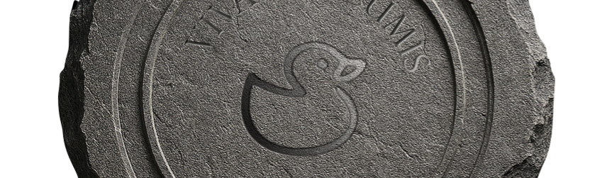

# RDCore.Forms
<sup>_Ce document est disponible en [français](./README.fr.md)_</sup>



**RDForms** is the form toolkit of the [RDCore](https://github.com/rubberduck-vba/RDCore) platform: cross-platform forms for RD-VBA, built on [Avalonia](https://avaloniaui.net) and designed for MVVM. It imports the forms of VB6 projects (`.frm` + `.frx`) and the UserForms of VBA projects (MSForms), so their code runs with the same controls on Windows, Linux and macOS.

This repository holds two libraries:

| Package | Role |
|---|---|
| **RDCore.Forms** | The form model, with no UI dependency: component classes, their properties and events, the instances of a form, and the readers that import a form into the model. The language server reads and analyses a form with it, without loading Avalonia. |
| **RDCore.Forms.Avalonia** | The controls and the renderer: the controls of a form, and the window built from the model. |

RDCore's runtime runs the form's code. The host process that shows a form for the runtime is part of RDCore.

## Project status

RDCore.Forms is in **pre-alpha** development. Nothing is published yet: there is no package and no release, and the API will change.

**Contributions**

- Individuals: open ([CLA](CLA.md)). One signature covers every RDCore repository.
- Corporate: planned.

[](https://github.com/rubberduck-vba/RDCore.Forms/actions/workflows/build.yml)

## Licence

RDCore.Forms is licensed under the **MIT** licence (see [LICENSE](LICENSE)). Part of its code comes from [HexIDE](https://github.com/hexide-io/HexIDE), also MIT: [NOTICE.md](NOTICE.md) names its source and reproduces its licence.

## Building

From the repository root, with the .NET 10 SDK:

```
dotnet build RDCore.Forms.slnx
dotnet test RDCore.Forms.slnx
```

The control tests run on Avalonia's headless platform, so they need no display.

---
### See also
- [RDCore](https://github.com/rubberduck-vba/RDCore)
- [RDCore.SDK](https://github.com/rubberduck-vba/RDCore.SDK)
- [HexIDE](https://github.com/hexide-io/HexIDE)
